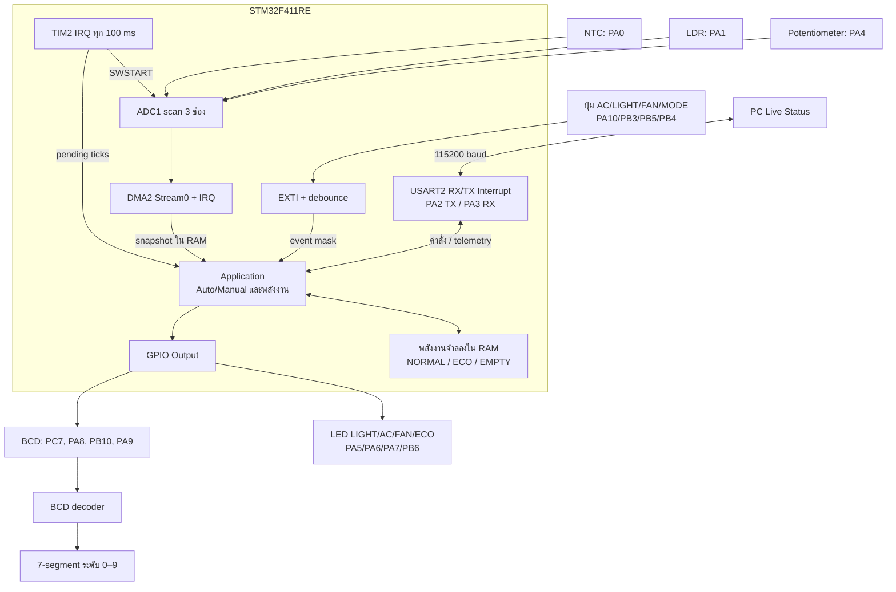
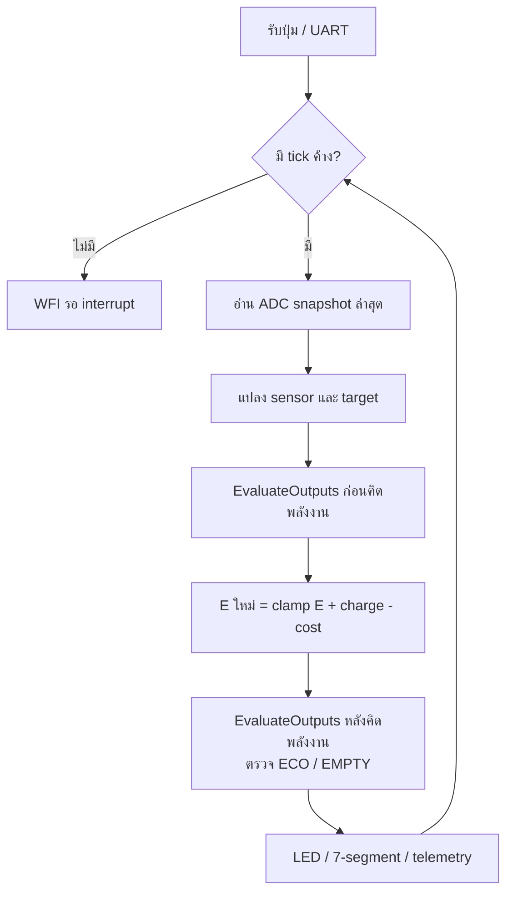

# Block diagram — Smart_Home_final

ลูกศรแสดงข้อมูลและคำสั่ง ไม่ใช่เส้นทางจ่ายไฟ แผนภาพตรงกับพฤติกรรมฐาน 1.4 R3

## หน้าที่และเส้นทางข้อมูล

1. TIM2 เริ่ม scan ADC ทุก 100 ms; DMA ส่งค่าทั้งสามลง RAM และ interrupt บันทึก snapshot
2. EXTI รับการกดปุ่ม ส่วน USART2 รับคำสั่ง PC ลงคิว ทั้งคู่ส่งให้ application ตัดสินใจใน main
3. Application แปลง ADC เป็นอุณหภูมิ/ความสว่าง/target แล้วประเมินโหลดก่อนและหลังอัปเดตพลังงาน
4. GPIO ขับ LED และรหัส BCD ตาม state; telemetry กลับ PC ผ่านคิว TX และ UART interrupt

แผนภาพล่างเป็นรอบปกติ ไม่รวม startup test 2 s และ display test 20 s ที่พักพลังงาน ค่า ADC เป็นชุดล่าสุดที่ทำเสร็จ ไม่ได้รอชุดใหม่ใน tick เดียวกัน และ UART/ADC ไม่มี loop รอรับ sample แบบ polling

แสงน้อยทำให้ชาร์จน้อยและไฟ Auto อาจเปิด จึงเร่งการลดแบตจำลอง เมื่อผ่าน 4→3 เข้า ECO ตัดแอร์/พัดลมครั้งเดียว เมื่อ E=0 เข้า EMPTY และรอสะสมถึง 6000 units ก่อนปลดล็อก
